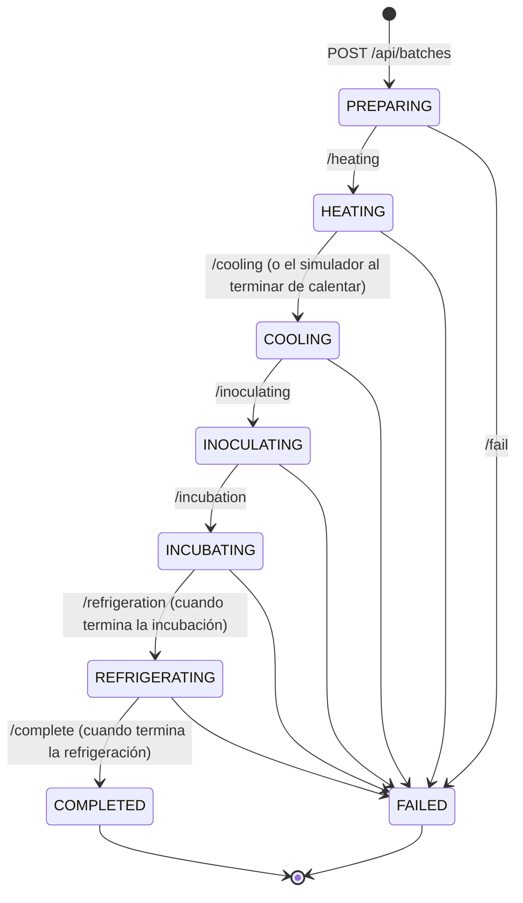

# 🥛 Yogurt Maker API

[](https://github.com/Sebxx66/YogurtMaker/actions/workflows/ci.yml)


[](LICENSE)

API REST para gestionar la fabricación de yogurt artesanal: recetas, lotes de producción y control de temperatura en cada fase del proceso.

Cada lote sigue un ciclo de vida con reglas claras: no se puede incubar un lote que no se ha inoculado, ni refrigerarlo antes de que termine la incubación. Mientras el lote avanza, un simulador genera lecturas de temperatura como lo haría un sensor real, y la API entrega el historial, un resumen estadístico y un panel con el estado de la producción.

## Contenido

- [Funcionalidades](#funcionalidades)
- [Tecnologías](#tecnologías)
- [Cómo ejecutarlo](#cómo-ejecutarlo)
- [Ciclo de vida de un lote](#ciclo-de-vida-de-un-lote)
- [Endpoints](#endpoints)
- [Ejemplo de uso](#ejemplo-de-uso)
- [Manejo de errores](#manejo-de-errores)
- [Arquitectura](#arquitectura)
- [Pruebas](#pruebas)
- [Configuración](#configuración)
- [Próximos pasos](#próximos-pasos)

## Funcionalidades

- **Recetas**: creación, edición, búsqueda y activación o desactivación, con sus ingredientes y los parámetros de cada fase (temperaturas y tiempos).
- **Lotes de producción**: ciclo de vida con transiciones validadas, código único por lote (`YB-20260512-K7QM`) y tiempos de incubación y refrigeración controlados.
- **Control de temperatura**: lecturas automáticas del simulador o registradas manualmente, historial filtrable por fechas y resumen de la incubación (mínima, máxima y promedio).
- **Monitoreo**: lotes en proceso y panel con la cantidad de lotes por estado y los terminados en el día.
- **Errores claros**: respuestas en formato [RFC 9457 (Problem Details)](https://www.rfc-editor.org/rfc/rfc9457) con el código HTTP adecuado.
- **Documentación interactiva** con Swagger UI.

## Tecnologías

| Tecnología | Uso |
|---|---|
| Java 21 | Lenguaje (records, sealed interfaces, switch expressions) |
| Spring Boot 4 | Web MVC, Data JPA, Validation, Actuator |
| H2 | Base de datos en memoria |
| SpringDoc OpenAPI | Documentación y Swagger UI |
| Lombok | Menos código repetitivo en las entidades |
| JUnit 5, MockMvc, AssertJ | Pruebas unitarias y de integración |
| GitHub Actions | Integración continua |
| Docker | Imagen lista para desplegar |

## Cómo ejecutarlo

**Requisitos:** Java 21. No hace falta instalar Maven: el proyecto trae el wrapper.

```bash
git clone https://github.com/Sebxx66/YogurtMaker.git
cd YogurtMaker
./mvnw spring-boot:run          # En Windows: mvnw.cmd spring-boot:run
```

La API queda en `http://localhost:8081` y arranca con dos recetas de ejemplo.

| Recurso | URL |
|---|---|
| Swagger UI | http://localhost:8081/swagger-ui.html |
| OpenAPI (JSON) | http://localhost:8081/v3/api-docs |
| Consola H2 | http://localhost:8081/h2-console (JDBC URL `jdbc:h2:mem:yogurtdb`, usuario `sa`, sin contraseña) |
| Estado de la app | http://localhost:8081/actuator/health |

**Con Docker:**

```bash
docker build -t yogurt-maker .
docker run -p 8081:8081 yogurt-maker
```

## Ciclo de vida de un lote



Las reglas de transición viven en un solo lugar, el enum `BatchStatus`. Un intento de saltarse una fase responde `409 Conflict` con un mensaje que explica en qué estado está el lote.

**Simulador de temperatura.** Al pasar a `HEATING`, el simulador sube la temperatura de la leche hasta la de la receta, la mantiene el tiempo indicado, pasa el lote a `COOLING` y enfría hasta la temperatura de inoculación. Durante `INCUBATING` registra lecturas periódicas. Corre en segundo plano después de que se confirma cada transacción, y se detiene solo si el lote cambia de estado (por ejemplo, si se descarta). Se puede desactivar con `yogurt.simulation.enabled=false` para avanzar el proceso a mano.

## Endpoints

### Recetas: `/api/recipes`

| Método | Ruta | Descripción |
|---|---|---|
| `POST` | `/api/recipes` | Crear receta |
| `GET` | `/api/recipes` | Listar recetas activas |
| `GET` | `/api/recipes/{id}` | Consultar receta |
| `PUT` | `/api/recipes/{id}` | Actualizar receta e ingredientes |
| `GET` | `/api/recipes/search?keyword=` | Buscar por nombre o descripción |
| `PATCH` | `/api/recipes/{id}/deactivate` | Desactivar receta |
| `PATCH` | `/api/recipes/{id}/activate` | Activar receta |

### Lotes: `/api/batches`

| Método | Ruta | Descripción |
|---|---|---|
| `POST` | `/api/batches` | Iniciar lote (`PREPARING`) |
| `GET` | `/api/batches?status=` | Listar lotes, con filtro opcional por estado |
| `GET` | `/api/batches/{id}` | Consultar lote |
| `POST` | `/api/batches/{id}/heating` | `PREPARING` → `HEATING` |
| `POST` | `/api/batches/{id}/cooling` | `HEATING` → `COOLING` |
| `POST` | `/api/batches/{id}/inoculating` | `COOLING` → `INOCULATING` |
| `POST` | `/api/batches/{id}/incubation` | `INOCULATING` → `INCUBATING` |
| `POST` | `/api/batches/{id}/refrigeration` | `INCUBATING` → `REFRIGERATING` |
| `POST` | `/api/batches/{id}/complete` | `REFRIGERATING` → `COMPLETED` |
| `POST` | `/api/batches/{id}/fail` | Descartar el lote (`FAILED`) |
| `POST` | `/api/batches/{id}/temperature` | Registrar una lectura manual |

### Monitoreo: `/api/monitoring`

| Método | Ruta | Descripción |
|---|---|---|
| `GET` | `/api/monitoring/batches/active` | Lotes en proceso |
| `GET` | `/api/monitoring/batches/{id}/temperature` | Última lectura y estadísticas de la incubación |
| `GET` | `/api/monitoring/batches/{id}/temperature-logs?start=&end=` | Historial de temperatura |
| `GET` | `/api/monitoring/dashboard` | Lotes por estado, activos y terminados hoy |

## Ejemplo de uso

```bash
# 1. Iniciar un lote con la receta 1 y 8 horas de incubación
curl -X POST http://localhost:8081/api/batches \
  -H "Content-Type: application/json" \
  -d '{"recipeId": 1, "customIncubationHours": 8}'

# 2. Empezar a calentar (el simulador lo llevará solo a COOLING)
curl -X POST http://localhost:8081/api/batches/1/heating

# 3. Ver cómo cambia la temperatura
curl http://localhost:8081/api/monitoring/batches/1/temperature-logs
```

Respuesta del paso 1:

```json
{
  "id": 1,
  "batchCode": "YB-20260512-K7QM",
  "recipeId": 1,
  "recipeName": "Yogurt natural",
  "status": "PREPARING",
  "milkVolume": 2.0,
  "starterAmount": 2.0,
  "targetTemperature": 45.0,
  "incubationTime": 8,
  "startTime": "2026-05-12T08:00:00"
}
```

## Manejo de errores

Todos los errores siguen el formato Problem Details:

```json
{
  "type": "about:blank",
  "title": "Conflicto con el estado actual",
  "status": 409,
  "detail": "El lote YB-20260512-K7QM está en PREPARING y no puede pasar a INCUBATING",
  "instance": "/api/batches/1/incubation"
}
```

| Código | Cuándo |
|---|---|
| `400` | Campos inválidos (incluye `errors` con el detalle de cada campo) o solicitud mal formada |
| `404` | La receta o el lote no existe |
| `409` | Transición no permitida, tiempo de proceso sin cumplir o nombre de receta repetido |
| `422` | Datos coherentes por separado pero no en conjunto (por ejemplo, incubación mínima mayor que la máxima) |

## Arquitectura

Arquitectura en capas, con DTOs separados de las entidades para no exponer el modelo de base de datos:

```
src/main/java/com/sebxx66/yogurtmaker
├── config/        Reloj, OpenAPI, ejecución asíncrona y datos de ejemplo
├── controller/    Endpoints REST
├── dto/           Solicitudes y respuestas (records con validación)
├── exception/     Excepciones de dominio y manejador global
├── model/         Entidades JPA y estados del lote
├── repository/    Repositorios Spring Data
└── service/       Lógica de negocio
    └── simulation/  Simulador de temperatura basado en eventos
```

Algunas decisiones de diseño:

- **Reloj inyectable (`java.time.Clock`).** Las pruebas adelantan el tiempo para verificar que no se puede refrigerar antes de terminar la incubación, sin esperar horas.
- **Eventos después del commit.** El simulador escucha con `@TransactionalEventListener(AFTER_COMMIT)` y corre con `@Async`, así nunca trabaja sobre datos que todavía no se han guardado.
- **Bloqueo optimista (`@Version`).** Si el usuario y el simulador cambian el mismo lote a la vez, uno de los dos recibe `409` en lugar de sobrescribir el cambio del otro.

## Pruebas

```bash
./mvnw verify
```

- `BatchStatusTest`: reglas de transición entre estados.
- `RecipeApiTest`: creación, validación, duplicados, edición de ingredientes y búsqueda.
- `BatchLifecycleTest`: el ciclo completo de un lote de principio a fin, tiempos de incubación y refrigeración, descarte de lotes y estadísticas de temperatura.

GitHub Actions ejecuta las pruebas en cada push y en cada pull request.

## Configuración

Se configura en `src/main/resources/application.yml`:

| Propiedad | Valor por defecto | Descripción |
|---|---|---|
| `server.port` | `8081` | Puerto de la API |
| `yogurt.demo-data` | `true` | Carga recetas de ejemplo si la base está vacía |
| `yogurt.simulation.enabled` | `true` | Activa el simulador de temperatura |
| `yogurt.simulation.tick` | `2s` | Tiempo real entre lecturas al calentar y enfriar |
| `yogurt.simulation.incubation-reading-interval` | `5m` | Tiempo real entre lecturas durante la incubación |

Con el perfil `dev` (`./mvnw spring-boot:run -Dspring-boot.run.profiles=dev`) la consola muestra las consultas SQL.

## Próximos pasos

- Base de datos persistente (PostgreSQL) con migraciones en Flyway.
- Autenticación con Spring Security y JWT.
- Paginación en los listados.
- Integración con un sensor de temperatura real en lugar del simulador.

## Autor

**Jhoan Sebastián Palacio Zapata**: estudiante de Tecnología en Desarrollo de Software en la Universidad Católica Luis Amigó.

[GitHub](https://github.com/Sebxx66) · [LinkedIn](https://www.linkedin.com/in/jhoan-palacio-dev)

## Licencia

Distribuido bajo la licencia MIT. Consulta [LICENSE](LICENSE).
